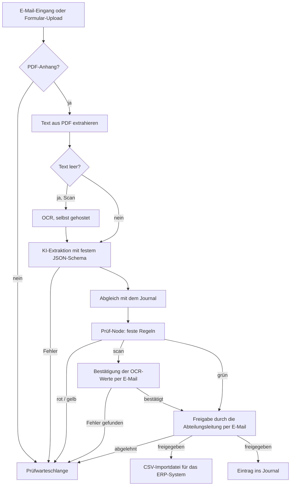

# KI-gestützte Rechnungsverarbeitung mit n8n

Prototyp, der die manuelle Erfassung von Eingangsrechnungen automatisiert: vom PDF-Eingang über Prüfung und Freigabe bis zur CSV-Importdatei für ein ERP-System.

**Kernidee:** KI nur dort, wo sie nötig ist. Ein Sprachmodell macht aus dem Rechnungstext strukturierte Daten, feste Regeln prüfen das Ergebnis, und Menschen entscheiden über die Freigabe.

## Ablauf

**Prüfwarteschlange:** alle Rechnungen, die ein Mensch klären muss, mit Begründung. **Journal:** alle verarbeiteten Rechnungen, zur Duplikaterkennung.

Der Prüf-Node ([`code/pruef_node.py`](code/pruef_node.py)) gibt jeder Rechnung einen Status mit Begründung:

| Status | Bedeutung |
|---|---|
| 🔴 rot | z. B. Summe falsch, Duplikat, IBAN weicht ab |
| 🟡 gelb | z. B. Lieferant oder Kostenstelle unbekannt |
| 🔵 scan | alles ok, aber Werte aus OCR → Bestätigung durch einen Menschen |
| 🟢 grün | alles ok → Freigabe |

## Tech-Stack

n8n (selbst gehostet, Docker Compose) · Python · Gemini API · Stirling-PDF (OCR)

## Setup

1. In `docker/` die `.env.example` nach `.env` kopieren und ausfüllen
2. `docker compose up -d` und n8n unter `http://localhost:5678` öffnen
3. Workflows aus `workflow/` importieren und Credentials anlegen (Gemini, SMTP, Stirling-PDF)

## Grenzen

- Nur der erste Anhang pro E-Mail, nur ein Steuersatz pro Rechnung
- Stammdaten fest im Code statt aus dem ERP
- Nur mit erfundenen Testdaten getestet
